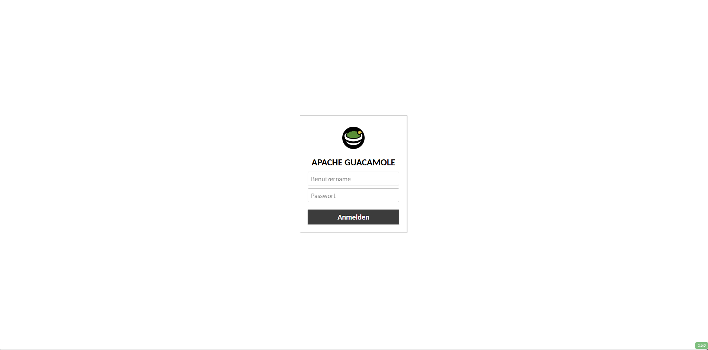
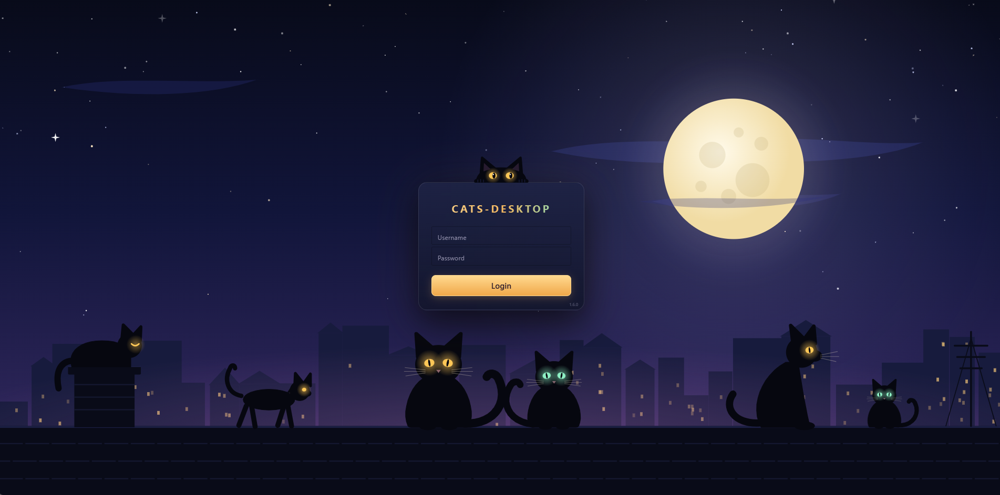

# guacamole-cats 🐈‍⬛

🇩🇪 [Deutsch](#deutsch) · 🇬🇧 [English](#english)

| Original | Katzen-Nacht |
| :---: | :---: |
|  |  |

---

## Deutsch

**Katzen-Nacht** ist ein dunkles, katzenthemiertes Design für [Apache Guacamole](https://guacamole.apache.org/): Nachtblau mit bernsteinfarbenen Akzenten, einer Katzen-Szene auf dem Login-Screen und eigenem Favicon. Die Texte gibt es auf Deutsch und Englisch, die Sprache richtet sich nach dem Browser.

### Installation

1. Die neueste `guacamole-cat-theme.jar` unter [Releases](../../releases/latest) herunterladen.
2. In das Extensions-Verzeichnis von Guacamole kopieren, z. B. `/etc/guacamole/extensions/` (bei Docker: `<GUACAMOLE_HOME>/extensions/`).
3. Guacamole bzw. den Servlet-Container (Tomcat) neu starten und die Seite mit Strg+F5 neu laden.

Zum Entfernen die Datei wieder löschen und neu starten.

### Anpassen

- Farben: `css/cat-theme.css` (Variablen am Anfang der Datei)
- Texte/Name: `translations/de.json`, `translations/en.json`
- Favicon: `resources/images/favicon.svg`

Die `.jar` ist nur eine umbenannte ZIP-Datei. Selbst bauen:

```
zip -r guacamole-cat-theme.jar guac-manifest.json css js resources translations
```

### Hinweis

Die Versionsnummer auf dem Login-Screen stammt von Guacamole selbst und wird vom Theme nur gestaltet.

---

## English

**Katzen-Nacht** ("cat night") is a dark, cat-themed look for [Apache Guacamole](https://guacamole.apache.org/): night blue with amber accents, a cat scene on the login screen and a custom favicon. Texts are available in German and English, chosen by the browser language.

### Installation

1. Download the latest `guacamole-cat-theme.jar` from [Releases](../../releases/latest).
2. Copy it into Guacamole's extensions directory, e.g. `/etc/guacamole/extensions/` (Docker: `<GUACAMOLE_HOME>/extensions/`).
3. Restart Guacamole or the servlet container (Tomcat) and hard-reload the page with Ctrl+F5.

To remove the theme, delete the file and restart.

### Customizing

- Colors: `css/cat-theme.css` (variables at the top of the file)
- Texts/name: `translations/de.json`, `translations/en.json`
- Favicon: `resources/images/favicon.svg`

The `.jar` is just a renamed ZIP file. Build it yourself:

```
zip -r guacamole-cat-theme.jar guac-manifest.json css js resources translations
```

### Note

The version number on the login screen comes from Guacamole itself; the theme only styles it.
